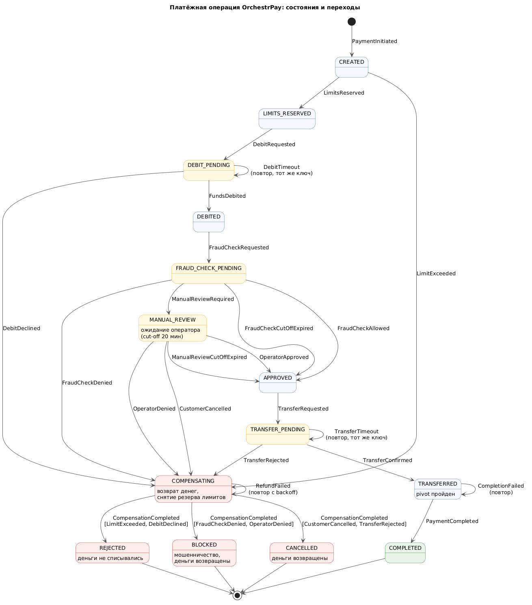

# Задание 2. State Machine платёжной операции

| Артефакт | Файл |
|---|---|
| Таблица переходов | этот файл, раздел [Таблица переходов](#таблица-переходов) |
| Диаграмма состояний | [payment-state-machine.puml](payment-state-machine.puml) → [payment-state-machine.png](payment-state-machine.png) |

Таблица переходов реализована в прототипе [Task4.2](../Task4.2): `PaymentStateMachine` в [`app/state_machine.py`](../Task4.2/payment-service/app/state_machine.py) отклоняет любой переход, которого нет в таблице. Каждый переход записывается в журнал `payment_events`.

## Состояния

| Состояние | Смысл | Где деньги |
|---|---|---|
| `CREATED` | Платёж создан, Saga запущена | у клиента |
| `LIMITS_RESERVED` | Лимиты проверены, сумма зарезервирована | у клиента |
| `DEBIT_PENDING` | Запрос на списание отправлен в банк, ждём подтверждения | у клиента или на транзитном счёте; выясняется запросом статуса по ключу идемпотентности |
| `DEBITED` | Деньги списаны на транзитный счёт платформы | транзитный счёт |
| `FRAUD_CHECK_PENDING` | Идёт антифрод-проверка, запущен таймер cut-off | транзитный счёт |
| `MANUAL_REVIEW` | Ждём решения оператора, максимум 20 минут | транзитный счёт |
| `APPROVED` | Проверки пройдены: решение `ALLOW`, решение оператора или cut-off | транзитный счёт |
| `TRANSFER_PENDING` | Запрос на перевод контрагенту отправлен | транзитный счёт или у контрагента; выясняется запросом статуса |
| `TRANSFERRED` | Деньги у контрагента, pivot пройден | у контрагента |
| `COMPLETED` | Финальное. Платёж проведён | у контрагента |
| `COMPENSATING` | Идут компенсации: возврат денег, снятие резерва лимитов. Причина сохраняется в платеже | транзитный счёт → клиент |
| `REJECTED` | Финальное. Отказ до списания: лимит или отказ банка | у клиента |
| `BLOCKED` | Финальное. Операция признана мошеннической, деньги возвращены, служба безопасности уведомлена | у клиента |
| `CANCELLED` | Финальное. Отмена клиентом или отказ в переводе контрагенту, деньги возвращены | у клиента |

## Таблица переходов

| Исходное состояние | Переходное состояние | Событие |
|---|---|---|
| — | `CREATED` | `PaymentInitiated`: клиент инициировал оплату заказа, запущен экземпляр Saga |
| `CREATED` | `LIMITS_RESERVED` | `LimitsReserved`: лимиты проверены, сумма зарезервирована |
| `CREATED` | `COMPENSATING` | `LimitExceeded`: превышен лимит клиента |
| `LIMITS_RESERVED` | `DEBIT_PENDING` | `DebitRequested`: в банк отправлен запрос на списание |
| `DEBIT_PENDING` | `DEBIT_PENDING` | `DebitTimeout`: банк не ответил вовремя. Повторяем запрос с тем же ключом идемпотентности или запрашиваем статус операции |
| `DEBIT_PENDING` | `DEBITED` | `FundsDebited`: банк подтвердил списание |
| `DEBIT_PENDING` | `COMPENSATING` | `DebitDeclined`: банк отказал (нет средств, счёт заблокирован) |
| `DEBITED` | `FRAUD_CHECK_PENDING` | `FraudCheckRequested`: запрос в FraudCheck Service, запущен таймер cut-off |
| `FRAUD_CHECK_PENDING` | `APPROVED` | `FraudCheckAllowed`: антифрод вернул «Разрешение» |
| `FRAUD_CHECK_PENDING` | `COMPENSATING` | `FraudCheckDenied`: антифрод вернул «Запрет» |
| `FRAUD_CHECK_PENDING` | `MANUAL_REVIEW` | `ManualReviewRequired`: антифрод вернул «Ручная проверка», создана задача оператору |
| `FRAUD_CHECK_PENDING` | `APPROVED` | `FraudCheckCutOffExpired`: проверка не ответила до cut-off-time, по умолчанию разрешено |
| `MANUAL_REVIEW` | `APPROVED` | `OperatorApproved`: оператор разрешил операцию |
| `MANUAL_REVIEW` | `COMPENSATING` | `OperatorDenied`: оператор запретил операцию |
| `MANUAL_REVIEW` | `APPROVED` | `ManualReviewCutOffExpired`: оператор не принял решение за 20 минут, по умолчанию разрешено |
| `MANUAL_REVIEW` | `COMPENSATING` | `CustomerCancelled`: клиент отменил платёж, пока шла ручная проверка |
| `APPROVED` | `TRANSFER_PENDING` | `TransferRequested`: отправлен перевод контрагенту |
| `TRANSFER_PENDING` | `TRANSFER_PENDING` | `TransferTimeout`: банк не ответил вовремя. Повторяем с тем же ключом идемпотентности |
| `TRANSFER_PENDING` | `TRANSFERRED` | `TransferConfirmed`: деньги зачислены контрагенту (pivot пройден) |
| `TRANSFER_PENDING` | `COMPENSATING` | `TransferRejected`: банк отказал в переводе, например счёт контрагента закрыт |
| `TRANSFERRED` | `TRANSFERRED` | `CompletionFailed`: технический сбой при фиксации статуса. Шаг повторяется, откат невозможен |
| `TRANSFERRED` | `COMPLETED` | `PaymentCompleted`: статус зафиксирован, событие отправлено в «Финансы» |
| `COMPENSATING` | `COMPENSATING` | `RefundFailed`: технический сбой возврата. Возврат повторяется автоматически с экспоненциальной задержкой |
| `COMPENSATING` | `REJECTED` | `CompensationCompleted` при причине `LimitExceeded` или `DebitDeclined`: деньги не списывались, резерв лимитов снят |
| `COMPENSATING` | `BLOCKED` | `CompensationCompleted` при причине `FraudCheckDenied` или `OperatorDenied`: деньги возвращены, служба безопасности уведомлена |
| `COMPENSATING` | `CANCELLED` | `CompensationCompleted` при причине `CustomerCancelled` или `TransferRejected`: деньги возвращены клиенту |

## Ответы на вопросы задания

- **Антифрод вернул отказ.** `FRAUD_CHECK_PENDING → COMPENSATING → BLOCKED`. В `COMPENSATING` деньги возвращаются клиенту, резерв лимитов снимается, параллельно уходит уведомление в службу безопасности. Деньги контрагенту не уходили, потому что перевод стоит после проверок.
- **Сработал таймер cut-off.** Из `FRAUD_CHECK_PENDING` или `MANUAL_REVIEW` платёж переходит в `APPROVED`, и дальше всё идёт как при обычном подтверждении. Источник решения (`CUT_OFF`) сохраняется для аудита. Если поздний ответ антифрода — «Запрет», запускается отдельный процесс пост-фактум возврата.
- **Операция подтверждена.** `APPROVED → TRANSFER_PENDING → TRANSFERRED → COMPLETED`. После `TRANSFERRED` (pivot) переходов в `COMPENSATING` нет: оставшиеся шаги только повторяются.
- **Ручная проверка.** `FRAUD_CHECK_PENDING → MANUAL_REVIEW`. Платёж ждёт в этом состоянии до решения оператора, до cut-off в 20 минут или до отмены клиентом. Ожидание хранится в Camunda, поэтому переживает рестарты сервисов.

## Инварианты

- Из финальных состояний (`COMPLETED`, `REJECTED`, `BLOCKED`, `CANCELLED`) переходов нет.
- `REJECTED` возможен только если списания не было. `BLOCKED` и `CANCELLED` возможны только после завершённого возврата.
- В `COMPENSATING` нельзя попасть после `TRANSFERRED`.
- Время в `DEBIT_PENDING`, `TRANSFER_PENDING`, `MANUAL_REVIEW` и `COMPENSATING` ограничено. Если оно превышено, это «зависший» платёж, и его ловит fitness-функция ([Task6](../Task6)).

