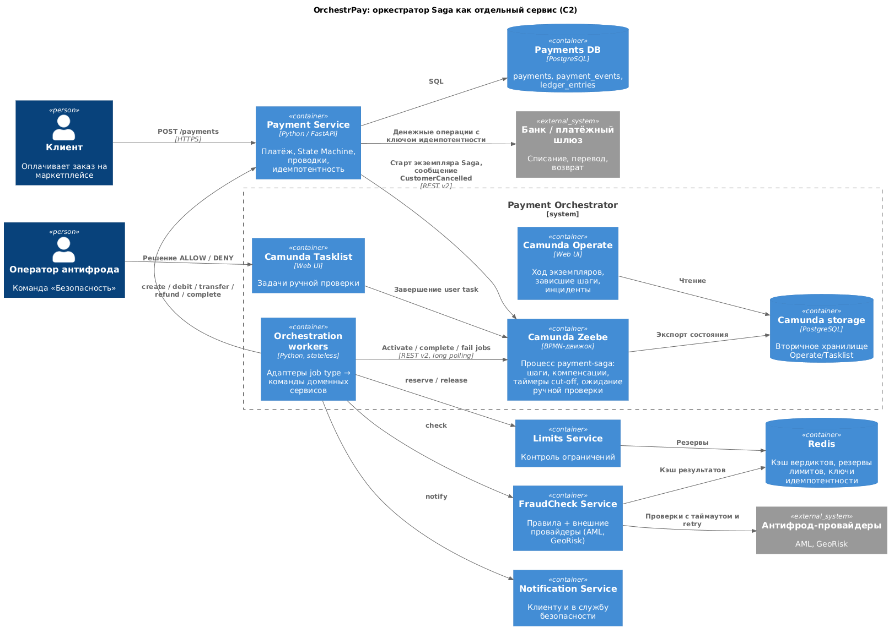

# ADR-001. Где разместить оркестратор Saga обработки платежа

### Автор
Никита Соловьёв

### Дата
09.11.2026

### Статус
Принято

## Контекст

OrchestrPay выбрал Saga-оркестрацию для ключевого процесса: оплаты на маркетплейсе. Процесс проходит через несколько сервисов:

| Шаг ([Task1](../Task1)) | Владелец |
|---|---|
| `CREATE_PAYMENT`, `DEBIT_FUNDS`, `TRANSFER_TO_MERCHANT`, `REFUND_FUNDS`, `COMPLETE_PAYMENT` | Payment Service, команда «Обработка транзакций» |
| `RESERVE_LIMITS` / `RELEASE_LIMITS` | Сервис контроля ограничений (вне скоупа) |
| `FRAUD_CHECK`, `MANUAL_FRAUD_REVIEW` | FraudCheck Service, команда «Безопасность» |
| `NOTIFY_CUSTOMER`, `NOTIFY_SECURITY` | Notification Service |
| Compliance-проверки | Сервисы compliance (вне скоупа) |

Нужно решить, где живёт функция оркестрации: последовательность шагов, компенсации, таймеры cut-off, ожидание ручной проверки до 20 минут и ретраи. Варианты: внутри одного из доменных сервисов (естественный кандидат — Payment Service) или в отдельном сервисе-оркестраторе. Исполнение — на Camunda BPMN, это требование компании.

### Функциональные требования

| № | Действующие лица или системы | Use Case | Описание |
|---|---|---|---|
| 1 | Клиент, Payment Service | Проведение платежа | Списание → антифрод → перевод контрагенту. Успешная транзакция — менее 5 с в 90% случаев |
| 2 | FraudCheck Service, оператор антифрода | Ручная проверка | Платёж ждёт решения оператора до 20 минут. Когда истекает cut-off, платёж разрешается по умолчанию |
| 3 | Payment Service, Notification Service, служба безопасности | Блокировка мошеннической операции | Мгновенный возврат денег клиенту и уведомление службы безопасности |
| 4 | Payment Service | Автоматические возвраты | Возврат при сбоях, при отмене клиентом и при мошенничестве — в моменте и пост-фактум, без ручной работы поддержки |
| 5 | Бизнес, служба безопасности, SRE | Прозрачность | Видно, на каком шаге транзакция, где зависла и где упала |
| 6 | Бизнес-эксперты | Изменение процесса | Новая compliance-проверка или новое значение cut-off без переписывания доменных сервисов |

### Нефункциональные требования

| № | Требование |
|---|---|
| 1 | Деньги не должны зависать между системами. Состояние Saga должно переживать рестарты и сбои |
| 2 | SLA: успешная транзакция — менее 5 с для 90% операций |
| 3 | Внешние вызовы — с таймаутами, retry, идемпотентностью и кэшированием результатов |
| 4 | Ошибка при проведении стоит дороже, чем потеря от отклонения: при сомнениях — не проводить |
| 5 | Над платформой работают несколько команд (Платёжные сервисы, Безопасность, Финансы, SRE). Изменения одной команды не должны блокировать другие |
| 6 | Будут и другие процессы: пост-фактум возвраты, отмены, сверка с банками |

## Решение

Оркестрацию выносим в **отдельный сервис Payment Orchestrator** на Camunda 8.

1. **Payment Orchestrator** состоит из двух частей:
   - кластер Camunda: движок Zeebe, Operate, Tasklist;
   - stateless job workers, адаптеры к доменным сервисам.

   BPMN-процесс [payment-saga](../Task4.1) — единственное место, где описаны порядок шагов, компенсации, таймеры cut-off и ожидание ручной проверки.
2. **Доменные сервисы не знают о Saga и друг о друге.** Они публикуют идемпотентные команды с ключом идемпотентности, например `debit(paymentId, key)`, `refund(...)`, `check(...)`, `reserve/release(...)`, `notify(...)`, и отвечают результатом или бизнес-ошибкой.
3. **Бизнес-правила остаются в доменах.** Правила лимитов — в сервисе ограничений, скоринг — в FraudCheck, денежные операции и State Machine платежа ([Task2](../Task2)) — в Payment Service. Оркестратор отвечает только за «что за чем и что делать при отказе».
4. **Владение.** Оркестратором и BPMN владеет команда «Обработка транзакций» отдела «Платёжные сервисы». Изменения процесса проходят ревью с командой «Безопасность» (антифрод-ветки) и бизнес-экспертами по BPMN-диаграмме. SRE отвечает за кластер Camunda: 3 брокера с репликацией, вторичное хранилище в PostgreSQL, алерты на инциденты.
5. **Ручная проверка — user task Camunda.** Операторы «Безопасности» работают в Tasklist или во встроенном в свой интерфейс Tasklist API. Отдельная очередь задач не нужна.

## Альтернативы

### 1. Оркестратор внутри Payment Service

Payment Service встраивает движок или держит BPMN и workers у себя и сам вызывает FraudCheck, лимиты, уведомления.

**Плюсы**
- Меньше компонентов и сетевых вызовов, быстрее запустить MVP.
- Статус платежа и состояние Saga можно менять в одной локальной транзакции.
- У процесса один естественный владелец, ведь платёж — домен Payment Service.

**Минусы**
- Payment Service становится «богом процесса»:
  - знает про антифрод, лимиты, compliance и уведомления, растёт связность;
  - любое изменение последовательности (новая проверка, другой cut-off) требует релиза самого критичного сервиса.
- Долгоживущее состояние (ожидание оператора до 20 минут, таймеры, ретраи) делит ресурсы и отказы с денежными операциями. Перегрузка таймерами или ретраями бьёт по проведению платежей.
- Остальным процессам (пост-фактум возвраты, отмены, сверка) тоже нужна оркестрация. Либо Payment Service оркестрирует всё, либо в каждом домене появляется свой движок и свой способ мониторинга.
- Команда Payment Service становится узким местом для изменений «Безопасности» и «Финансов» (противоречит НФТ 5).
- Прозрачность для бизнеса и безопасности завязана на внутренности одного сервиса.

**Где уместен:** простой процесс из 2–3 шагов внутри одного домена без ожиданий и человеческих задач.

### 2. Выбрано: отдельный сервис-оркестратор на Camunda

**Плюсы**
- **Слабая связность.** Доменные сервисы простые и переиспользуемые: те же `refund` и `notify` нужны процессам пост-фактум возвратов и отмен.
- **Процесс как артефакт.** BPMN читают бизнес и безопасность. Новая проверка или новый cut-off — новая версия процесса, доменные сервисы при этом не меняются, а запущенные экземпляры дорабатывают на старой версии.
- **Изоляция и масштабирование.** Долгоживущее состояние Saga (таймеры, ожидания, ретраи) хранится в Camunda и масштабируется отдельно от денежных операций. Workers stateless.
- **Прозрачность из коробки.** Operate показывает путь каждого экземпляра, шаг, на котором он завис, и инциденты, Tasklist даёт интерфейс оператору (ФТ 5).
- **Надёжность.** Состояние Saga персистентно и реплицировано. После сбоя процесс продолжается с того же шага (НФТ 1).

**Минусы**
- Ещё один платформенный компонент (кластер Camunda и его хранилище) со своими эксплуатацией, обновлениями и HA.
- Сетевой вызов на каждый шаг. На 8 шагов это десятки миллисекунд, при SLA 5 с это некритично.
- Два хранилища состояния: Camunda (Saga) и Payment Service (платёж). Нужны идемпотентность, сверка и fitness-функции согласованности ([Task6](../Task6)).
- Есть риск «умного оркестратора и анемичных сервисов», если бизнес-правила начнут переезжать в BPMN.

## Недостатки, ограничения, риски

| Риск / ограничение | Последствие | Митигирование |
|---|---|---|
| Недоступность кластера Camunda | Новые платежи не стартуют, текущие стоят на текущем шаге | 3 брокера с репликацией, PostgreSQL с репликой. Состояние не теряется. Алерт SRE. Деньги лежат на транзитном счёте, а не «между системами» |
| Расхождение статуса в Camunda и в Payment Service | Например, Saga завершена, а платёж в `TRANSFER_PENDING` | Идемпотентные команды с ключом. Fitness-функции сверки ([Task6](../Task6)): нет платежей в промежуточных статусах без активного экземпляра Saga и наоборот |
| Повторная доставка job (at-least-once) | Двойное списание или перевод | Ключи идемпотентности `debit/transfer/refund:{paymentId}` на стороне банка и Payment Service. При таймауте сначала запрос статуса операции |
| Бизнес-логика расползается в BPMN | Оркестратор становится монолитом правил | В BPMN только последовательность, развилки по результату шага, таймеры и компенсации. Правила лимитов и скоринга — в доменах. Архитектурные тесты (ArchUnit) запрещают workers обращаться к БД доменов |
| Изменение процесса ломает запущенные экземпляры | Ошибки в долгих ожиданиях (ручная проверка) | Версионирование BPMN: старые экземпляры дорабатывают на своей версии, при необходимости — миграция экземпляров |
| Задержка на сетевые вызовы | Рост времени транзакции | Long polling workers, вызовы с таймаутами, cut-off антифрода 3 с. Метрика длительности Saga и алерт на p90 > 5 с |
| Оператор не успевает за 20 минут | Платёж проходит по умолчанию (cut-off) | Приоритет Critical и срок в Tasklist, мониторинг очереди. Поздний «Запрет» запускает пост-фактум возврат |
