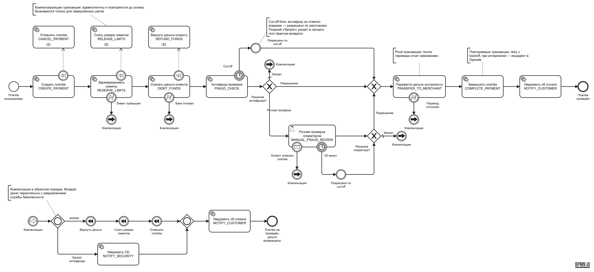

# Задание 4.1. BPMN-процесс обработки платежа

| Артефакт | Файл |
|---|---|
| BPMN-диаграмма (картинка) | [payment-saga.png](payment-saga.png) |
| Исходник BPMN 2.0 (Camunda 8, открывается в Camunda Modeler) | [payment-saga.bpmn](payment-saga.bpmn) |

Этот же файл без изменений исполняется в прототипе [Task4.2](../Task4.2): сервис деплоит его в Camunda 8.9 при старте. На стенде прогнаны все ветки диаграммы, скриншоты Operate лежат в [Task4.2/screenshots](../Task4.2/screenshots).

## Как читать диаграмму

**Основной поток (средний ряд).** `CREATE_PAYMENT` → `RESERVE_LIMITS` → `DEBIT_FUNDS` → `FRAUD_CHECK` → шлюз «Решение антифрода?» → `TRANSFER_TO_MERCHANT` → `COMPLETE_PAYMENT` → `NOTIFY_CUSTOMER` → «Платёж проведён». Названия шагов совпадают с реестром транзакций из [Task1](../Task1).

**Компенсационные транзакции (верхний ряд).** У каждого шага до pivot есть compensation boundary event (значок ⏪) и обработчик с маркером компенсации:

| Шаг | Компенсация |
|---|---|
| `CREATE_PAYMENT` | `CANCEL_PAYMENT` |
| `RESERVE_LIMITS` | `RELEASE_LIMITS` |
| `DEBIT_FUNDS` | `REFUND_FUNDS` |

Camunda вызывает обработчик, только если шаг успел завершиться. Поэтому при отказе банка в списании возврат денег не запускается: списания не было.

**Pivot-точка — `TRANSFER_TO_MERCHANT`.** У перевода нет компенсации. После него идут только повторяемые шаги: `COMPLETE_PAYMENT` и `NOTIFY_CUSTOMER` с `retries=10` и backoff. Если попытки кончились, в Operate появляется инцидент, но откат после pivot не запускается. Если банк отказал в самом переводе (`TRANSFER_REJECTED`), pivot не пройден, и Saga уходит в компенсацию.

**Развилки антифрода.**
- Шлюз «Решение антифрода?» по переменной `fraudDecision`:
  - «Разрешение» — сразу к переводу;
  - «Ручная проверка» — к user task оператора;
  - «Запрет» — в компенсацию. Это поток по умолчанию: неизвестный ответ трактуется как запрет. Так выполняется требование «ошибка проведения дороже отклонения».
- Шлюз «Решение оператора?» разводит решение оператора: «Разрешение» к переводу, «Запрет» в компенсацию.

**Ожидание ответа после ручной проверки.** `MANUAL_FRAUD_REVIEW` — Camunda user task: форма `manual-review-form`, группа `fraud-operators`, приоритет Critical, срок `now() + 20 минут`. Пока задача открыта, экземпляр процесса ждёт, и состояние хранится в Camunda. На задаче два граничных события:
- **таймер «20 минут»** — cut-off: промежуточное событие «Разрешено по cut-off» выставляет `fraudDecision = ALLOW`, `fraudDecisionSource = CUT_OFF` и ведёт к переводу;
- **сообщение «Клиент отменил платёж»** (`CustomerCancelled`, корреляция по `paymentId`) — прерывает ожидание и запускает компенсацию.

**Cut-off автоматической проверки.** Таймер на `FRAUD_CHECK` (`fraudCheckCutOff`, по умолчанию 3 с, чтобы уложиться в SLA 5 с) — по истечении «Разрешено по cut-off». Поздний ответ провайдера отбрасывается движком, сервис его логирует. Поздний «Запрет» уходит в отдельный процесс пост-фактум возврата.

**Автоматические возвраты (нижний ряд).** Все отказы ведут link-событиями «Компенсация» в один сегмент компенсации:
- лимит превышен;
- банк отказал;
- запрет антифрода;
- запрет оператора;
- отмена клиентом;
- перевод отклонён.

Внутри сегмента:
1. Inclusive gateway запускает параллельно две ветки:
   - **всегда** — компенсация в обратном порядке тремя compensation throw events с `activityRef`: «Вернуть деньги» (`REFUND_FUNDS`) → «Снять резерв лимитов» (`RELEASE_LIMITS`) → «Отменить платёж» (`CANCEL_PAYMENT`);
   - **только при запрете антифрода** — `NOTIFY_SECURITY`, уведомление службы безопасности.
2. После слияния — `NOTIFY_CUSTOMER` с шаблоном отмены и событие «Платёж не проведён, деньги возвращены».

Поддержка в возвратах не участвует: обработчики компенсаций идемпотентны и повторяются автоматически.

## Почему так

- **Параллельность.** Её показывает inclusive gateway в сегменте компенсации: возврат денег не ждёт уведомления службы безопасности, а уведомление отправляется только при мошенничестве.
- **Один сегмент компенсации вместо копии на каждый отказ.** Он вызывается из разных мест через link events. Какие шаги откатить, Camunda решает сама: компенсируются только завершённые шаги. Диаграмма остаётся читаемой для бизнес-экспертов.
- **Строгий порядок компенсаций.** Throw events с `activityRef` идут последовательно: сначала деньги клиенту, потом лимиты, последним — финальный статус платежа. Без `activityRef` Camunda запускает обработчики одновременно и без гарантии порядка.
- **Всё, что нужно для восстановления, хранится в движке.** Текущий шаг, ожидание оператора, таймеры cut-off и счётчики ретраев хранятся в Camunda. После рестарта сервиса процесс продолжается с того же места, а Operate показывает, на каком шаге «завис» платёж.
