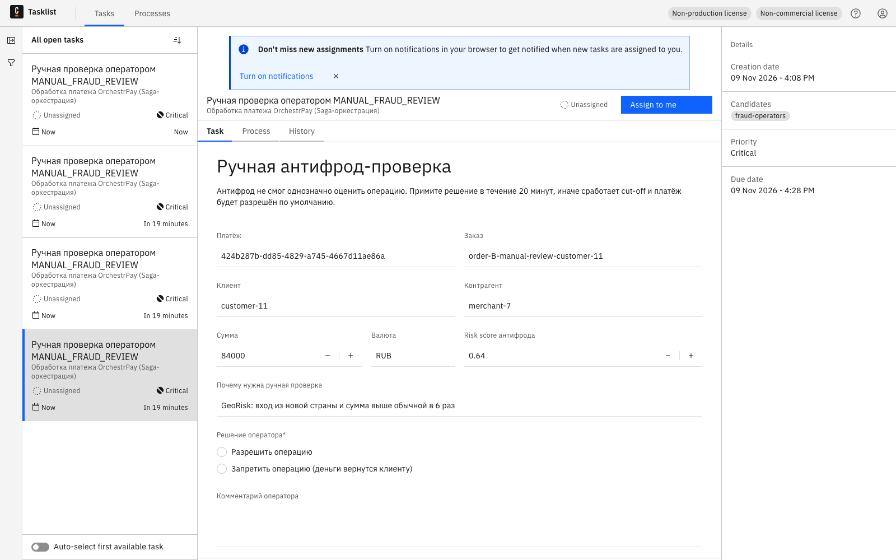
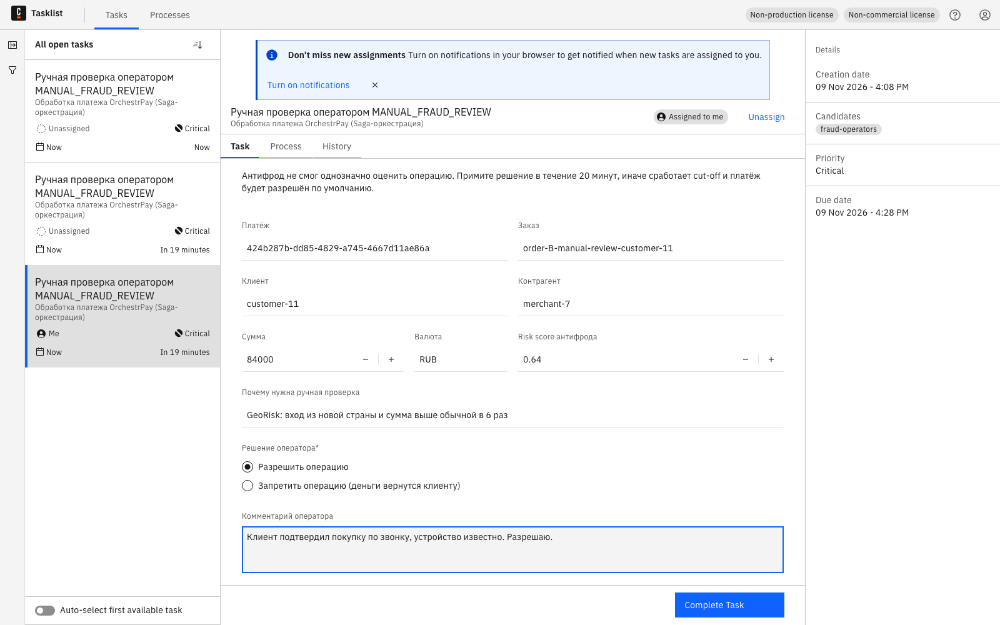
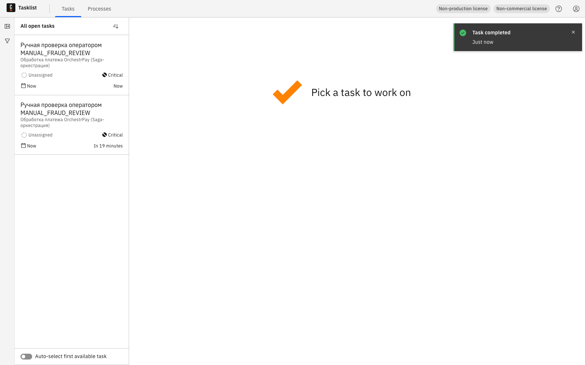
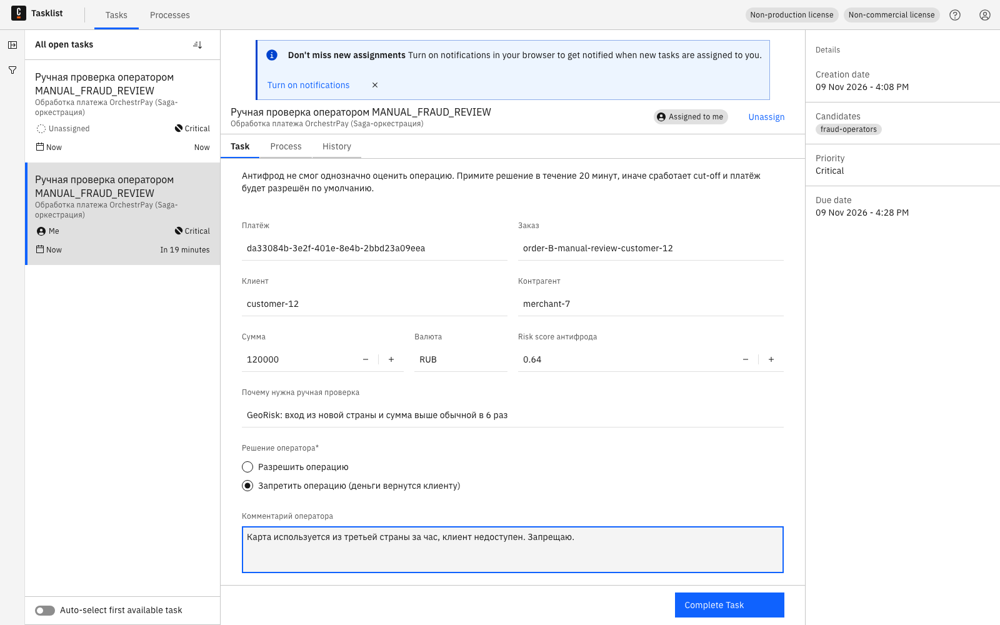
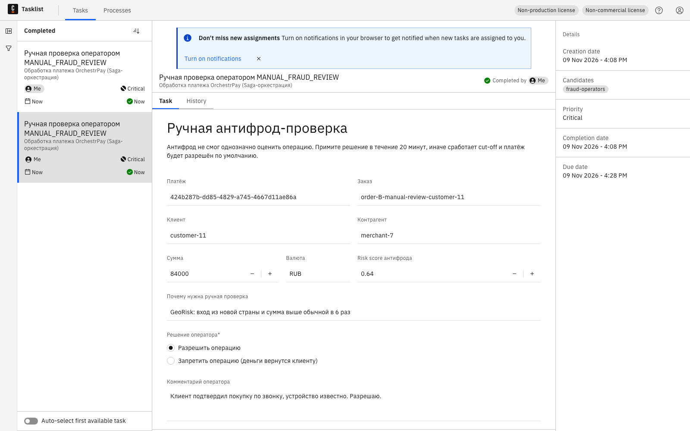
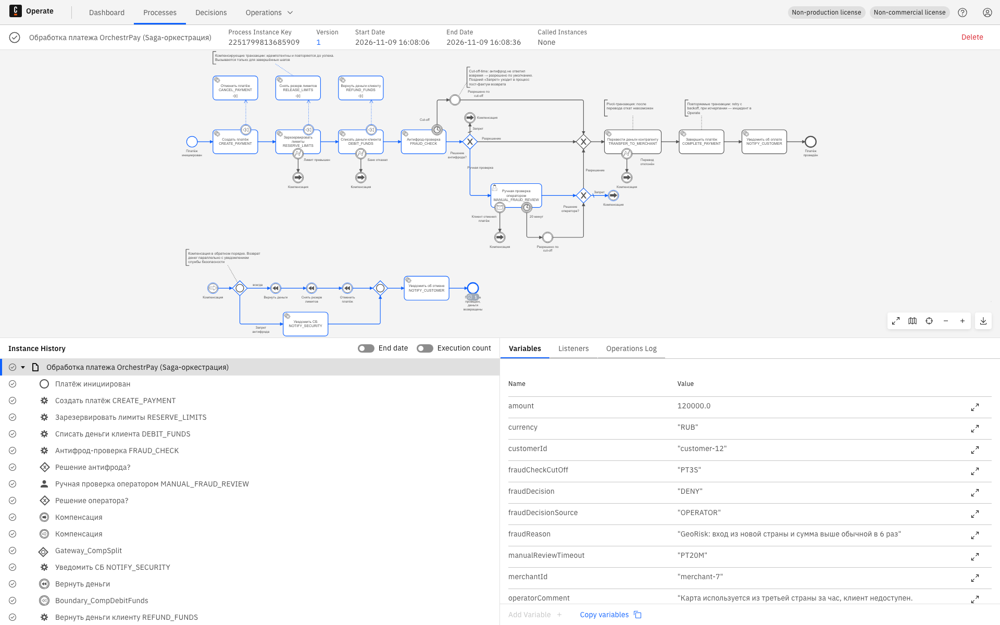
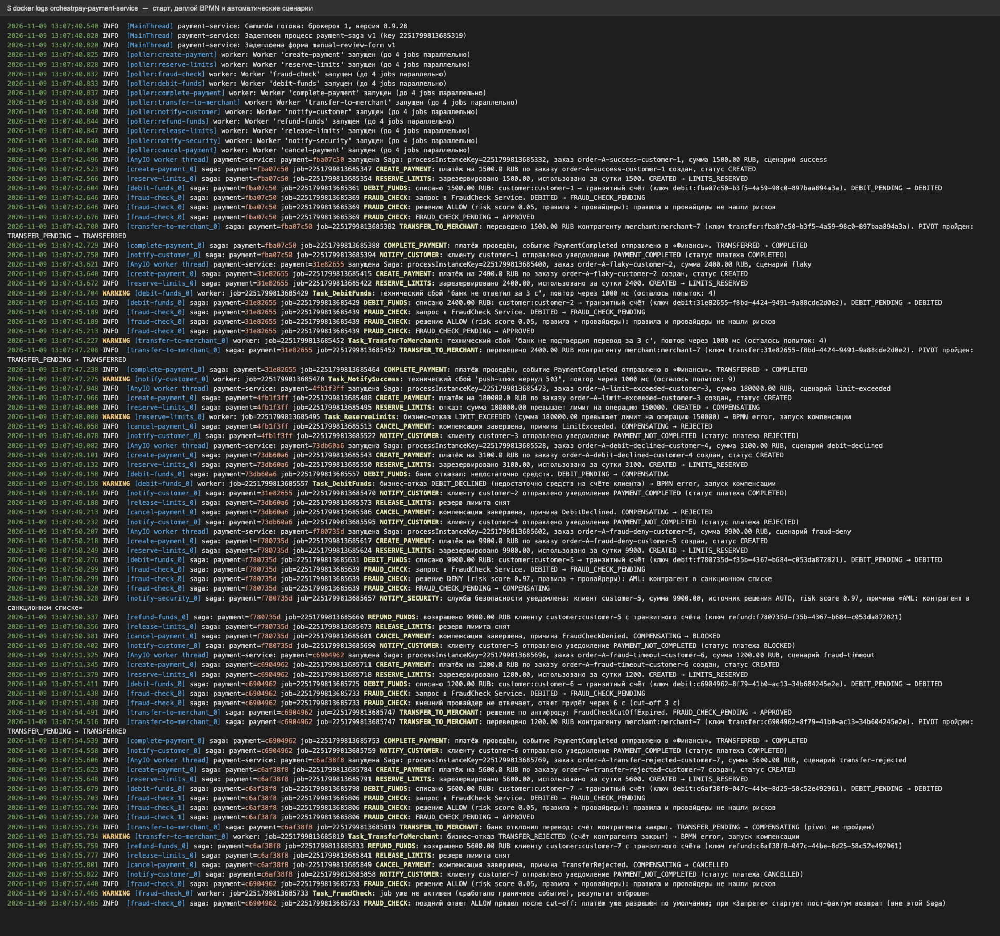
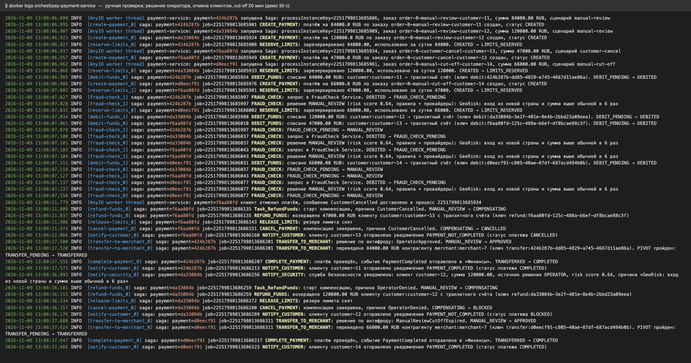

# Задание 4.2. Прототип процесса на Camunda

Минимальный прототип оркестратора платежа: сервис на Python с job workers, процесс [payment-saga.bpmn](payment-service/bpmn/payment-saga.bpmn) из [Task4.1](../Task4.1) и стек Camunda 8 в docker-compose.

| Артефакт | Где |
|---|---|
| Код сервиса | [payment-service/app](payment-service/app) |
| Dockerfile образа сервиса | [payment-service/Dockerfile](payment-service/Dockerfile) |
| BPMN и форма ручной проверки (вшиваются в образ, деплоятся при старте) | [payment-service/bpmn](payment-service/bpmn) |
| docker-compose (Camunda + PostgreSQL + Redis + сервис) | [docker-compose.yaml](docker-compose.yaml), [camunda/application.yaml](camunda/application.yaml), [postgres/init.sql](postgres/init.sql) |
| Скрипт прогона сценариев | [demo/run-demo.sh](demo/run-demo.sh) |
| Скриншоты Tasklist, Operate и лога сервиса | [screenshots/](screenshots) |
| Логи прогона | [logs/](logs) |

## Стек

| Контейнер | Образ | Зачем |
|---|---|---|
| `orchestration` | `camunda/camunda:8.9.28` | Orchestration Cluster Camunda 8: Zeebe (BPMN-движок), **Tasklist**, Operate и REST API v2 в одном контейнере |
| `postgres` | `postgres:17` | Две БД: `camunda` — вторичное хранилище Camunda для Tasklist и Operate (RDBMS, без Elasticsearch), `payments` — данные Payment Service |
| `redis` | `redis:alpine` | Резервы лимитов, кэш результатов антифрода, ключи идемпотентности уведомлений и заказов |
| `payment-service` | собирается из [Dockerfile](payment-service/Dockerfile) | REST API платежей и 11 job workers (по одному на тип задачи в BPMN) |

> **Почему Camunda 8, а не 7.** У Camunda 7 Community Edition закончилась поддержка, и образы `camunda/camunda-bpm-platform` из Docker Hub удалены. Camunda 8.9 — актуальная версия. В ней Tasklist — отдельный UI для пользовательских задач, а с версии 8.9 вторичным хранилищем может быть PostgreSQL, поэтому Elasticsearch не нужен. Конфигурация оркестратора взята из официального [camunda-distributions](https://github.com/camunda/camunda-distributions/tree/main/docker-compose/versions/camunda-8.9).

**Автоматизация деплоя.** Образ сервиса собирается из Dockerfile, BPMN-процесс и форма лежат внутри образа. При старте сервис:
1. ждёт готовности Camunda;
2. создаёт схему БД;
3. деплоит процесс и форму через `POST /v2/deployments` (повторный деплой без изменений новую версию не создаёт);
4. запускает workers.

Вручную в Modeler ничего загружать не нужно.

## Запуск

```bash
cd Task4.2
docker compose up -d --build          # ~1 минута до готовности Camunda
./demo/run-demo.sh auto               # 7 автоматических сценариев
./demo/run-demo.sh manual             # 4 платежа с ручной проверкой
```

| Что | Адрес |
|---|---|
| Tasklist (решения оператора) | http://localhost:8080/tasklist, `demo` / `demo` |
| Operate (ход каждого экземпляра) | http://localhost:8080/operate, `demo` / `demo` |
| API сервиса (Swagger) | http://localhost:8000/docs |

API сервиса:

| Метод | Что делает |
|---|---|
| `POST /payments` | Инициирует платёж и запускает экземпляр Saga. Идемпотентен по `orderId` |
| `POST /payments/{id}/cancel` | Отмена клиентом во время ручной проверки: сообщение `CustomerCancelled` в процесс |
| `GET /payments/{id}` | Статус, журнал переходов State Machine и проводки (`transitBalance` должен быть 0) |

## Устройство сервиса

Оркестрация, как и решено в [ADR](../Task3/ADR.md), живёт вне доменной логики. Порядок шагов, компенсации, таймеры и ожидание оператора задаёт BPMN в Camunda. Workers — адаптеры «job type → команда». Ради минимальности прототипа workers и имитации доменных сервисов (Payment, Limits, FraudCheck, Notification) собраны в один контейнер. В целевой архитектуре workers вызывают API отдельных сервисов.

| Модуль | Что делает |
|---|---|
| [`camunda_client.py`](payment-service/app/camunda_client.py) | Тонкий клиент REST API v2: deploy, create process instance, activate / complete / fail jobs, BPMN error, correlate message |
| [`worker.py`](payment-service/app/worker.py) | Job worker с long polling и пулом потоков. `BusinessError` превращается в BPMN error и ведёт в компенсацию. Любое другое исключение — fail job с `retries - 1` и экспоненциальным `retryBackOff`, при нуле ретраев — инцидент в Operate |
| [`handlers.py`](payment-service/app/handlers.py) | Обработчики шагов Saga. Каждый идемпотентен: при повторной доставке job смотрит состояние платежа и не повторяет сделанное |
| [`state_machine.py`](payment-service/app/state_machine.py) | Таблица переходов из [Task2](../Task2) один в один. Переход вне таблицы — исключение |
| [`repository.py`](payment-service/app/repository.py) | PostgreSQL: `payments`, журнал `payment_events`, проводки `ledger_entries` с уникальным ключом идемпотентности |
| [`external.py`](payment-service/app/external.py) | Имитации банка, контроля лимитов, FraudCheck (кэш вердикта в Redis), Notification. Поведение задаётся сценарием |

| Job type (BPMN) | Транзакция | Переходы State Machine |
|---|---|---|
| `create-payment` | `CREATE_PAYMENT` | — → `CREATED` |
| `reserve-limits` | `RESERVE_LIMITS` | `CREATED` → `LIMITS_RESERVED` / `COMPENSATING` + BPMN error `LIMIT_EXCEEDED` |
| `debit-funds` | `DEBIT_FUNDS` | `LIMITS_RESERVED` → `DEBIT_PENDING` (→ `DebitTimeout`) → `DEBITED` / `COMPENSATING` + `DEBIT_DECLINED` |
| `fraud-check` | `FRAUD_CHECK` | `DEBITED` → `FRAUD_CHECK_PENDING` → `APPROVED` / `MANUAL_REVIEW` / `COMPENSATING` |
| user task | `MANUAL_FRAUD_REVIEW` | решение оператора в Tasklist |
| `transfer-to-merchant` | `TRANSFER_TO_MERCHANT` | → `APPROVED` (решение оператора или cut-off) → `TRANSFER_PENDING` → `TRANSFERRED` / `COMPENSATING` + `TRANSFER_REJECTED` |
| `complete-payment` | `COMPLETE_PAYMENT` | `TRANSFERRED` → `COMPLETED` |
| `notify-customer` | `NOTIFY_CUSTOMER` | — |
| `refund-funds`, `release-limits` | `REFUND_FUNDS`, `RELEASE_LIMITS` | → `COMPENSATING` (если причина пришла из Camunda: оператор или отмена клиентом) |
| `cancel-payment` | `CANCEL_PAYMENT` | `COMPENSATING` → `REJECTED` / `BLOCKED` / `CANCELLED` |
| `notify-security` | `NOTIFY_SECURITY` | — |

## Результаты прогона

Все 11 сценариев покрывают все ветки BPMN. Каждый экземпляр процесса в Camunda завершился без инцидентов (см. [07-operate-process-instances.png](screenshots/07-operate-process-instances.png)). Итог по каждому платежу из БД сервиса лежит в [logs/payments-final-state.log](logs/payments-final-state.log), там же запрос fitness-функции «деньги не зависли на транзитном счёте»: он вернул 0 строк.

| Сценарий | Что происходит | Итог | Переходы State Machine |
|---|---|---|---|
| `success` | всё проходит | `COMPLETED` | … `FraudCheckAllowed` → `TransferConfirmed` → `PaymentCompleted` |
| `flaky` | первая попытка списания, перевода и уведомления падает по таймауту, ретрай проходит идемпотентно | `COMPLETED` | … `DebitTimeout` → `FundsDebited` … `TransferTimeout` → `TransferConfirmed` … |
| `limit-exceeded` | 180 000 ₽ больше лимита на операцию | `REJECTED` | `LimitExceeded` → `CompensationCompleted`, проводок нет |
| `debit-declined` | банк отказал в списании | `REJECTED` | `DebitDeclined` → `CompensationCompleted`, возврата нет: списания не было |
| `fraud-deny` | антифрод: AML-запрет | `BLOCKED` | `FraudCheckDenied` → `CompensationCompleted`. Проводки DEBIT, REFUND; СБ уведомлена |
| `fraud-timeout` | провайдер ответил через 6 с при cut-off 3 с | `COMPLETED` | `FraudCheckCutOffExpired` → …; поздний ответ отброшен и залогирован |
| `transfer-rejected` | счёт контрагента закрыт | `CANCELLED` | `TransferRejected` → `CompensationCompleted`, деньги вернулись клиенту |
| `manual-review` № 1 | оператор **разрешил** в Tasklist | `COMPLETED` | `ManualReviewRequired` → `OperatorApproved` → … |
| `manual-review` № 2 | оператор **запретил** в Tasklist | `BLOCKED` | `ManualReviewRequired` → `OperatorDenied` → `CompensationCompleted`, СБ уведомлена |
| `customer-cancel` | клиент отменил платёж во время ручной проверки | `CANCELLED` | `ManualReviewRequired` → `CustomerCancelled` → `CompensationCompleted` |
| `manual-cut-off` | оператор не успел (cut-off на стенде 30 с вместо 20 мин) | `COMPLETED` | `ManualReviewRequired` → `ManualReviewCutOffExpired` → … |

## Скриншоты

### Tasklist UI

Ручная антифрод-проверка: четыре платежа ждут решения оператора (группа `fraud-operators`, приоритет Critical, срок 20 минут).



Оператор назначил задачу на себя, выбрал «Разрешить операцию» и оставил комментарий.



Задача завершена, процесс продолжился: дальше перевод контрагенту.



Второй платёж оператор запретил: деньги вернутся клиенту, служба безопасности получит уведомление.



Завершённые задачи: решение и комментарий оператора сохранены.



### Operate: ход процессов

| Скриншот | Что видно |
|---|---|
| [06-operate-dashboard.png](screenshots/06-operate-dashboard.png) | Дашборд после прогона: 0 запущенных («зависших») экземпляров и 0 инцидентов, все 11 завершились |
| [07-operate-process-instances.png](screenshots/07-operate-process-instances.png) | Все экземпляры `payment-saga` в состоянии Completed, на диаграмме счётчики по элементам |
| [08-operate-instance-operator-allow.png](screenshots/08-operate-instance-operator-allow.png) | Оператор разрешил: пройденный путь через ручную проверку к переводу |
| [09-operate-instance-operator-deny-compensation.png](screenshots/09-operate-instance-operator-deny-compensation.png) | Оператор запретил: компенсация (возврат, снятие лимитов, отмена) и параллельное уведомление СБ |
| [10-operate-instance-fraud-cut-off.png](screenshots/10-operate-instance-fraud-cut-off.png) | Антифрод не ответил: сработал таймер cut-off, платёж разрешён по умолчанию |
| [11-operate-instance-customer-cancel.png](screenshots/11-operate-instance-customer-cancel.png) | Отмена клиентом: сообщение прервало ожидание оператора, деньги возвращены |



### Лог сервиса: обработчики выполнялись

Автоматические сценарии. Видны ретраи технических сбоев (`WARNING … повтор через 1000 мс`), BPMN errors с запуском компенсации, cut-off антифрода и отброшенный поздний ответ.



Ручная проверка: решение оператора, отмена клиентом, cut-off.



Полный лог — [logs/payment-service.log](logs/payment-service.log). Вывод скрипта прогона — [logs/demo-auto.log](logs/demo-auto.log) и [logs/demo-manual.log](logs/demo-manual.log).

## Как прототип закрывает требования

- **Деньги не зависают.**
  - Проводки идемпотентны по ключу (`debit:` / `transfer:` / `refund:{paymentId}`). При повторе с тем же ключом новая проводка не создаётся, а состояние операции сначала проверяется.
  - Остаток транзитного счёта по каждому завершённому платежу равен 0, это проверено запросом в [logs/payments-final-state.log](logs/payments-final-state.log).
- **Состояние Saga и ожидания.** Текущий шаг, ожидание оператора и таймеры cut-off хранит Camunda. Состояние платежа хранит State Machine сервиса, журнал переходов — `payment_events`.
- **Таймауты, retry, идемпотентность, кэш.**
  - Технические сбои ретраятся с экспоненциальным backoff.
  - Бизнес-отказы сразу ведут в компенсацию.
  - Вердикт антифрода кэшируется в Redis, поэтому ретрай не вызывает провайдера повторно.
  - Повторные уведомления подавляются.
- **Прозрачность.** Operate показывает путь каждого экземпляра и шаг, на котором он завис или упал (инциденты). `GET /payments/{id}` возвращает журнал переходов и проводки для бизнеса и службы безопасности.
